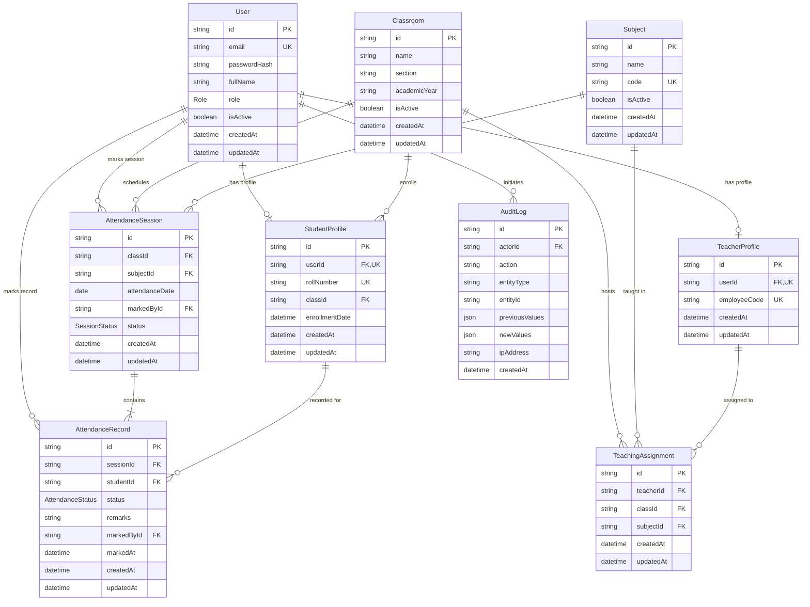

# Database Architecture & Entity-Relationship Design

The **Cloud-Based Student Attendance Management System** utilizes a fully normalized PostgreSQL relational schema managed by **Prisma ORM**. The database is hosted on **Amazon RDS for PostgreSQL**.

---

## 1. Entity-Relationship (ER) Diagram

---

## 2. Table Dictionaries & Referential Actions

### A. `User` Table
Central authentication table for all institutional actors.
- **Constraints**:
  - `PRIMARY KEY (id)`
  - `UNIQUE (email)` (case-insensitive indexing)
- **Role Enum**: `ADMIN`, `TEACHER`, `STUDENT`.
- **Security**: Passwords are never stored in plain text; they are hashed using `bcrypt` (10 salt rounds).

### B. `StudentProfile` Table
Stores student academic credentials.
- **Foreign Keys**:
  - `userId` -> `User(id)` `ON DELETE CASCADE`
  - `classId` -> `Classroom(id)` `ON DELETE RESTRICT` (prevents deleting active classes containing enrolled students)
- **Constraints**:
  - `UNIQUE (rollNumber)`
  - `INDEX (classId)` for fast roster retrieval.

### C. `TeacherProfile` Table
Stores faculty employment identifiers.
- **Foreign Keys**:
  - `userId` -> `User(id)` `ON DELETE CASCADE`
- **Constraints**:
  - `UNIQUE (employeeCode)`

### D. `Classroom` Table
Defines student cohorts and sections.
- **Constraints**:
  - `PRIMARY KEY (id)`
  - `UNIQUE (name, section, academicYear)` prevents duplicate cohort entries.

### E. `Subject` Table
Stores curriculum courses.
- **Constraints**:
  - `PRIMARY KEY (id)`
  - `UNIQUE (code)` (e.g., `CS401`, `CS402`).

### F. `TeachingAssignment` Table
Maps which teachers are authorized to teach and record attendance for a specific class and subject.
- **Constraints**:
  - `UNIQUE (teacherId, classId, subjectId)` strictly prevents duplicate teaching allocations.
  - `INDEX (classId, subjectId)`.

### G. `AttendanceSession` Table
Represents an attendance lecture event.
- **Date Strategy**: Uses PostgreSQL `DATE` column (`@db.Date`) ensuring no timezone drift occurs between UTC and Asia/Kolkata (IST).
- **Constraints**:
  - `UNIQUE (classId, subjectId, attendanceDate)` guarantees only **one attendance session** can exist per class, subject, and date.
  - `INDEX (attendanceDate)` optimizes historical date range searches.

### H. `AttendanceRecord` Table
Stores individual student attendance outcomes.
- **Enum Values**: `PRESENT`, `ABSENT`, `LATE`, `EXCUSED`.
- **Constraints**:
  - `UNIQUE (sessionId, studentId)` strictly prevents duplicate student records within any attendance session.
  - `INDEX (studentId, status)` optimizes student attendance percentage calculation queries.

### I. `AuditLog` Table
Maintains compliance trail of system mutations.
- **Actor Referential Action**: `ON DELETE SET NULL` ensures logs are retained even if an actor account is deleted.
- **Payload Sanitization**: Strips passwords, hashes, and session tokens before persisting to JSON columns.

---

## 3. Database Indexes for Query Optimization

1. `User(email)`: Instant lookup during login.
2. `StudentProfile(classId, rollNumber)`: Fast retrieval of class rosters ordered by roll number.
3. `TeachingAssignment(classId, subjectId)`: Authorization lookup during attendance submission.
4. `AttendanceSession(classId, subjectId, attendanceDate)`: Unique constraint index and date range scanning.
5. `AttendanceRecord(studentId, status)`: Fast aggregation of Present, Absent, Late, Excused counts.
6. `AuditLog(entityType, entityId, createdAt)`: Rapid audit trail filtering.
